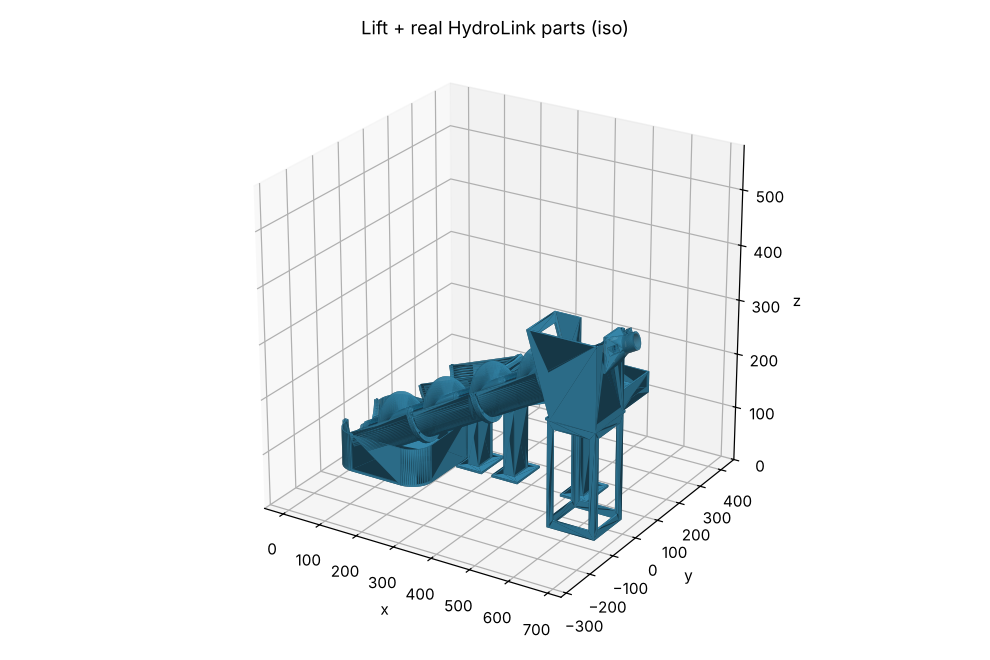

# HydroLink 5V mini water slide

A closed-loop water slide for floating minis. It is built from the open-source **HydroLink** waterway and **FlowLab** parts, plus a new **5 V motor-driven Archimedes screw lift** that carries both the water and the minis back up.



| Read this | For |
|---|---|
| [docs/BUILD_GUIDE.md](docs/BUILD_GUIDE.md) | your original build instructions, rewritten against the real parts: print settings and the motorizing, assembly and water-loop phases |
| [docs/BOM.md](docs/BOM.md) | printed parts, hardware, electronics |
| [docs/INTERFACES.md](docs/INTERFACES.md) | how the plan maps onto the HydroLink / FlowLab files, the measured interface numbers, and what was verified |
| [cad/lift/stl/REPORT.md](cad/lift/stl/REPORT.md) | generated part sizes, design checks, layout heights, riser list |
| [cad/lift/stl/FIT_REPORT.md](cad/lift/stl/FIT_REPORT.md) | overlap check against the real HydroLink meshes |

## Repository layout

```
cad/lift/build.py              parametric generator: all new parts -> cad/lift/stl/*.stl + REPORT.md
cad/lift/stl/                  print-ready STLs (print orientation) + _assembly.stl (world layout)
cad/tools/measure_hydrolink.py re-measures the interface numbers from the two 3MF files
cad/tools/check_fit.py         places the real HydroLink parts and checks every overlap
cad/tools/render_stl.py        PNG previews without a GPU
docs/                          build guide, BOM, interfaces, renders
PLAN.md                        the original planning notes (superseded by docs/)
```

## Regenerating

```
pip install -r cad/requirements.txt
python3 cad/lift/build.py                                    # STLs + REPORT.md; exits 1 if a check fails
python3 -I cad/tools/check_fit.py HydroLink_final_V1.33.3mf FlowLab3.3mf   # FIT_REPORT.md
```

All parameters (incline, screw size, segment count, basin placement, slide chain) are at the top of `cad/lift/build.py`.

The HydroLink and FlowLab 3MF files are not included. Print those parts from your own copies, and check the designer's license before redistributing anything derived from them.
