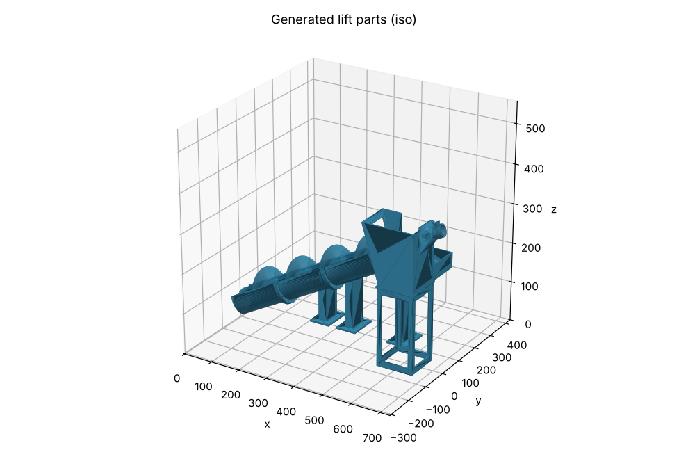

# Automated 5V HydroLink Mini Water Slide: build guide

A closed water loop for floating minis, built from the **HydroLink** and **FlowLab** parts plus a set of new printed parts for a **motor-driven Archimedes screw lift**. Everything electrical is 5 V DC, and the motor sits above the water.

Every dimension in this guide comes from the generator (`cad/lift/build.py`) and its reports. The interfaces were checked against the real HydroLink meshes (`cad/tools/check_fit.py`).



## 1. How the loop works

```
 Big basin (sump, water 50-60 mm deep)
   │  water + minis enter the open tail of the screw trough
   ▼
 Archimedes screw lift: 4 segments, 22° incline, ~200 mm lift, motor on the screw axis at the top
   │  screw pockets carry water AND floating minis
   ▼
 Head box: catches the discharge; side launder runs back toward the basin
   │  pour tip reaches 20 mm into the open top end of the first slide track
   ▼
 Slide (one rigid HydroLink chain, ~15° down):
   I track  →  FlowLab Flow modifier body + filter (staging gate)  →  I track
   │  open lower end overhangs the basin rim
   ▼
 Big basin  (loop closed)
```

Why it is laid out this way:

- **Archimedes screw, not a pump.** It is the only 5 V lift that carries the minis as well as the water. A printed impeller would move water only, and minis jam it. The motor is coaxial with the screw at the dry top end, so there is no shaft seal to leak.
- **Slide beside the lift.** HydroLink joints are rigid, so a slide made of clamped tracks is one tilted rigid body. It can only descend in one direction, so it runs back alongside the lift and spills into the same basin. The lift and the slide don't clamp to each other: the head box pours into the slide's open end, and the slide's open end pours into the basin. Those free ends absorb all the height differences.
- **Slope:** about 15°, a 114 mm fall over 418 mm. That is fast, which suits a slide. To make it gentler you need a longer chain (see section 7).

## 2. Parts you print

### From your HydroLink file (`HydroLink_final_V1.33.3mf`)

| Part | Qty | Notes |
|---|---|---|
| **I** (straight track) | 2 | the slide |
| **Big basin** | 1 | the sump. The Medium basin is too small: the trough needs ~146 mm inside the basin to rise over the rim, plus 80 mm behind the tail. |
| **Sealing insert** | 2 + one per End cap | one per sealing joint |
| **Clamps V2** | per joint, as the designer specifies | |
| **End cap** | one per unused Big-basin port | every basin port must be closed |

### From your FlowLab file (`FlowLab3.3mf`)

| Part | Qty | Notes |
|---|---|---|
| **Flow modifier_body** | 1 | the staging-gate frame, at the joint between the two I tracks |
| **Flow modifier**, filter variant | 1 | holds minis back, lets water through. Lift it out to release a batch. |
| **Floaty** | 10 | test "minis" with known dimensions |

### New lift parts (`cad/lift/stl/`)

| STL | Qty | Orientation as exported | Supports |
|---|---|---|---|
| `screw_segment_x4.stl` | **4** | upright, hex spigot up | **yes** (tree). The flight tips overhang. |
| `drive_hub.stl` | 1 | as exported | no |
| `trough_1_of_3_tail.stl` | 1 | standing, tail end (cross-bar) on the bed | no |
| `trough_2_of_3.stl`, `trough_3_of_3_top.stl` | 1 each | standing. The 45° chamfer under the top flange avoids supports. | no |
| `head_box.stl` | 1 | floor on the bed | paint-on supports under the curved **pour tip** only |
| `head_box_stand.stl` | 1 | as exported | no |
| `motor_mount.stl` | 1 | wall plate on the bed | no |
| `motor_hood.stl` | 1 | closed end on the bed | no |
| `riser_183mm.stl`, `riser_133mm.stl`, `riser_106mm.stl` | 1 each | base on the bed. Tops are pre-tilted to the slide slope. | no |

## 3. Slicer settings (Bambu P1S, the printer profile in both of your files)

Keep your water-tightness rules, which are stronger than the designer's 3 walls and 10% infill:

| Setting | Value |
|---|---|
| Material | **PETG** recommended (water, slight flex for clamps). PLA works for a summer of indoor use. |
| Walls | **4 minimum**. Trough walls are 4 mm, so they print fully solid. |
| Infill | **15% gyroid** |
| Top / bottom layers | 5 / 5 |
| Layer height | 0.2 mm (the screw at 0.16 mm prints smoother flights) |
| Screw segments | tree supports, 0.2 mm Z-gap; brim on |
| Clamps | follow the designer (their profile uses 8 walls on Clamps V2) |

## 4. Hardware

See [BOM.md](BOM.md). Key items:
- a **6 mm stainless rod, cut to 741 mm**
- a **686ZZ** bearing
- a **JGA25-370 6 V gear motor, 40–60 rpm, run at 5 V**
- a 4→6 mm flexible coupler
- M3 screws
- **6 mm OD / 4 mm ID silicone tube** for the HydroLink seals (vinyl tube won't seal)
- a 5 V USB supply with a PWM speed controller

## 5. Assembly

### Phase A: Motorizing (the lift)

1. **Screw.**
   - Stack the 4 segments on the rod. The hex spigot and key nub let them mate only with the flights in phase, giving one continuous helix.
   - Slide `drive_hub` onto the top spigot. Tap its radial hole M3 and lock it to the rod with a grub screw. This hub is the only torque path from the rod into the screw.
2. **Trough.**
   - Bolt `trough_1` (tail), `trough_2` and `trough_3` (top) flange-to-flange with M3 × 16 screws and nuts, four per joint.
   - Seal each flange with a thin bead of aquarium-safe silicone.
3. **Tail bearing.** Drop the rod's lower end into the boss on the tail cross-bar. That boss is the wet bushing; PETG on stainless at 40 rpm is fine.
4. **Head box.**
   - Bolt the top trough flange to the inclined front wall of `head_box` (4 × M3) and seal it with silicone.
   - Press the 686ZZ into the pocket on the back-wall boss. The rod passes through it.
   - Set the head box on `head_box_stand` (197 mm).
5. **Motor.**
   - Bolt `motor_mount` to the back wall (4 × M3).
   - Put the coupler on the rod, slide the gearbox into the clamp tube until its shaft seats in the coupler, then tighten the clamp screw.
   - Slip `motor_hood` over the clamp tube, with the cable exiting through the slot at the bottom.
6. **Wiring** (all 5 V): USB 5 V supply → 1 A polyfuse → PWM speed controller → motor. Add a drip loop so water can't run along the cable, and keep the supply and controller off the wet surface.
7. **Dry spin.**
   - Turn by hand first; nothing should rub (2 mm radial clearance).
   - Run at low PWM. When the screw's flights at the bottom move *up* the trough, the direction is right. If not, swap the motor wires.

### Phase B: Assembling the slide

1. **Track locking.**
   - Join **I → Flow modifier body → I** with sealing inserts and silicone tube in each joint, then clamp tight with **V2 clamps**.
   - This is the staging gate, at the top section of the slide. The designer's Flow blocker is a drop-in slab, not a sliding gate. The modifier body with the filter insert does the "hold minis, let water pass" job.
   - **Leave both ends of the chain open, with no End caps.** The top end receives the head-box pour tip; the bottom end spills into the basin.
2. **Risers.** Stand the three risers under the chain at these distances from its top end:

   | Distance from the top end | Riser |
   |---|---|
   | 15 mm | `riser_183mm` |
   | 200 mm (the gate joint) | `riser_133mm` |
   | 298 mm (just outside the basin rim) | `riser_106mm` |

3. **Position.**
   - The slide centreline runs parallel to the lift, **135 mm** to the launder side.
   - Push the chain up the slope until the pour tip sits **20 mm inside** the first track's open end. The tip is shaped to the track channel with a 1 mm gap and rides 7 mm above the track floor, clearing the seal ridge in the track's end zone.

### Phase C: Water circuit loop

1. **Basin.**
   - Close every Big-basin port with an End cap, sealing insert and silicone tube.
   - Place the basin so its centre is **63 mm** from the lift axis toward the slide, with the trough tail **80 mm** from the wall behind it.
   - The tail rests on the basin floor. The lift trough clears the basin's rounded corners by 5.3 mm (checked against the real basin mesh).
2. **Fill.** Fill to **50–60 mm** above the table, so the water reaches the screw axis at the tail. Lower water lifts less.
3. **Run.**
   - Start at low speed and raise it until water reaches the head box steadily. About 30–40 rpm should be plenty; the 2–10 L/min delivery figure is a rough estimate, so measure it.
   - Add Floaties or minis to the basin and watch them ride the screw pockets up. Each pocket is 33 mm deep and 129 mm long.
4. **Staging.** With the filter in the gate, minis queue at it. Lift the filter to drop a batch down the slide.

## 6. Leaks and safety

- The HydroLink designer rates the system **outdoor use, small leaks possible**. Build it in a sink, bathtub or shallow tray so every drip returns to the loop.
- Do a 10-minute **paper-towel test** under every joint before running indoors.
- 5 V DC only, with the motor and controller above the water. Use a USB supply with its own protection.
- The motor hood is a splash guard, not a waterproof enclosure. Don't submerge it.
- Supervise children; there is a rotating screw. The flights are blunt and the torque is low, but fingers should stay out of the trough.

## 7. Options and known limits

- **Vortex chamber (FlowLab Flow chamber + Vortex insert):** *not* in the default loop, because it has no working spot here:
  - **In the slide:** the slide is one rigid tilted chain, so the chamber would sit at about 15° and can't form a vortex.
  - **On the table as the basin's inlet** (your original plan): its drain exits under the floor and would flood at the 50–60 mm water level the screw needs.

  Both alternatives are open decisions:
  - a level vortex chamber on its own stand, fed by a short free-drop from the slide
  - a vortex shaped into the head box itself, with a drain big enough for minis
- **Gentler slide:** add level detour legs. Elbow → I → Elbow lengths running across the slope direction stay level and only add length. Then re-run the generator with the longer `SLIDE_CHAIN`.
- **Lower lift / smaller footprint:** set `N_SEG = 3` in `build.py`. The generator will then report that the spill end no longer reaches the basin with this chain, so shorten the chain to match.
- **Footprint:** about 740 × 250 mm for the lift plus the slide beside it. That is bathtub or large-tray scale rather than sink scale, because the HydroLink parts themselves are 200 mm tracks and a 250 mm basin.

## 8. Dry-fit before the first wet run

These can't be confirmed from the mesh files alone:

- [ ] The Flow modifier body clamps in a track joint as assumed (131 × 75.5 × 18 frame), and the filter insert drops into it.
- [ ] The Big basin floor and port positions. All ports must be capped; a port on the lift side may make the trough rest on its flange.
- [ ] The **22° incline vs the 25.5° flight angle**: test one screw segment in one trough piece with water before printing everything.
- [ ] The motor clamp grips your actual gearbox. Diameters vary by ±0.3 mm between JGA25 suppliers; the clamp slit takes up the difference.
- [ ] The Floaty or mini size passes the gate filter as you intend.

To change anything, edit the parameters at the top of `cad/lift/build.py`, then re-run:

```
pip install -r cad/requirements.txt
python3 cad/lift/build.py
python3 -I cad/tools/check_fit.py <HydroLink 3mf> <FlowLab 3mf>
```

Both scripts exit non-zero if any check fails.
